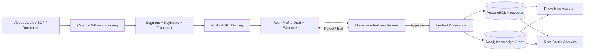

# MentorMind — Accumulate Master Know-How for AI to Learn

> **DENSO Factory Hacks 2026 · AI Challenge**  
> Số hóa know-how chuyên gia từ **video + lời giải thích + tài liệu**, xác minh bằng **Human-in-the-Loop**, rồi tái sử dụng qua **AI Assistant** và **Root Cause Analysis**.

[](#)
[](#)
[](#)
[](#)
[](#)

## Submission links

- **Public repository:** https://github.com/Trung1234/mentormind-knowhow-ai
- **Video demo:** https://youtu.be/OlgGrlv7kbk?si=__69vohalDVlmNP-
- **Full setup guide:** [`docs/setup.md`](docs/setup.md)
- **Architecture:** [`docs/architecture.md`](docs/architecture.md)

---

## 1. Đề bài

Xây dựng hệ thống thu thập workflow và cách suy luận của chuyên gia vào một knowledge base, kết hợp LLM để tái sử dụng tri thức cho các tác vụ tương tự — **không cần chuyên gia phải tự viết lại toàn bộ tài liệu thủ công**.

**Deliverables của đề bài:**

- Standardized Knowledge Capture Template
- Knowledge Base
- LLM Assistant
- Usefulness Evaluation Report

---

## 2. Vấn đề MentorMind giải quyết

Know-how trong nhà máy không chỉ nằm trong SOP. Một phần quan trọng nằm trong:

- thao tác thực tế của chuyên gia;
- lời giải thích “vì sao làm như vậy”;
- dấu hiệu quan sát được tại trạm làm việc;
- điều kiện, ngoại lệ và tiêu chí đạt;
- kinh nghiệm xử lý lỗi hình thành qua nhiều năm.

Nếu chỉ lưu video hoặc transcript, tri thức vẫn khó tìm kiếm và khó tái sử dụng. MentorMind chuyển evidence đa phương thức thành **WorkProfile có cấu trúc**, nhưng **AI chỉ tạo draft**; chuyên gia vẫn là người sửa, xác nhận hoặc từ chối trước khi tri thức được đưa vào kho dùng chung.

> **Nguyên tắc cốt lõi:** Video cho biết chuyên gia **làm gì**. Chuyên gia cho biết **tại sao**. MentorMind liên kết hai phần này thành tri thức có evidence và có thể tái sử dụng.

---

## 3. Golden Flow



### Output sau khi xử lý video

Một video sau khi phân tích có thể tạo ra:

1. **Segments** — các đoạn nhỏ dùng làm đơn vị xử lý kỹ thuật.
2. **Keyframe + clip đã cắt** — evidence trực quan của từng khoảng thời gian.
3. **ASR transcript** — lời nói chuyên gia được đồng bộ theo thời gian.
4. **VLM description** — mô tả hành động/đối tượng/quan sát trong từng segment.
5. **WorkProfile Draft** — bước nghiệp vụ có cấu trúc, ban đầu ở trạng thái draft/in-review.
6. **Evidence linkage** — WorkProfile liên kết ngược tới video ID, timestamp, keyframe, clip và transcript.
7. **Human Review** — chuyên gia kiểm tra action, observation, reason, pass criteria và gắn nhãn lỗi nếu AI nhận sai.

**Reason không được VLM tự “bịa”.** Reason chỉ được giữ khi có evidence từ lời chuyên gia/tài liệu hoặc được reviewer bổ sung và xác nhận.

---

## 4. Giao diện prototype

### Video analysis

Video được gắn **process code**, **cutting method** và **data classification** trước khi chạy pipeline. Kết quả hiển thị số segment, số WorkProfile draft, transcript và trạng thái xử lý.

### Human-in-the-Loop Review

Reviewer chọn từng WorkProfile để xem **keyframe, clip, timestamp và transcript**, sau đó sửa/duyệt/reject trước khi đồng bộ sang Knowledge Base.

### Know-How Assistant

Assistant truy xuất tri thức theo process line. Ở chế độ `live`, nguồn retrieval là tài liệu đã index và **bước video đã được Approve**; draft chưa duyệt không được xem là authoritative knowledge.

### Root Cause Analysis (5-Why)

RCA nhận production lot từ Sigma/MES mock feed hoặc symptom nhập tay để hỗ trợ tạo chuỗi 5-Why, failure hypotheses và preventive actions. Kết quả là **hỗ trợ điều tra**, không thay thế kết luận của kỹ sư.

---

## 5. Kiến trúc hệ thống

Ở cấu hình demo hiện tại, phần inference nặng có thể chạy trên máy chủ GPU riêng của đội; máy local chạy UI, API, database/graph và pre-processing video.

```text
Local machine
┌─────────────────────────────────────────────────────────────┐
│ React/Vite UI                                               │
│      ↓                                                      │
│ FastAPI                                                     │
│      ├── FFmpeg / PySceneDetect / MediaPipe                 │
│      ├── PostgreSQL 16 + pgvector (Docker)                  │
│      └── Neo4j 5 (Docker)                                   │
└───────────────┬─────────────────────────────────────────────┘
                │ HTTPS / OpenAI-compatible API
                ▼
Team inference server
┌─────────────────────────────────────────────────────────────┐
│ vLLM: Qwen3-VL                                             │
│ Gateway: ASR + Embeddings (BGE-M3) + Docling               │
└─────────────────────────────────────────────────────────────┘
```

Chi tiết các layer, schema `WorkProfile`, ràng buộc hạ tầng và roadmap: [`docs/architecture.md`](docs/architecture.md).

---

## 6. Tech stack

| Layer | Công nghệ |
|---|---|
| Frontend | React 19, Vite 7, TypeScript |
| Backend | Python 3.11/3.12, FastAPI, Uvicorn |
| Video processing | FFmpeg, PySceneDetect, MediaPipe |
| VLM | Qwen3-VL qua OpenAI-compatible endpoint / vLLM |
| ASR | Remote gateway hoặc faster-whisper local |
| Document extraction | Remote Docling gateway hoặc Docling local |
| Embedding | BGE-M3, dense vector 1024 chiều |
| Vector retrieval | PostgreSQL 16 + pgvector + FTS/unaccent |
| Knowledge Graph | Neo4j 5 + APOC |
| Evaluation | pytest, RAGAS/builtin judge, benchmark LASI |
| Local orchestration | Docker Compose + `uv` + npm |

---

## 7. Data governance

Mọi dữ liệu upload phải có classification:

- **Public** — dữ liệu công khai.
- **Synthetic** — dữ liệu giả lập/test.
- **Factory confidential** — dữ liệu nhà máy, bị DataGuard chặn khỏi cloud provider không được cho phép.

Nếu server inference của đội được public qua ngrok nhưng là hạ tầng self-host của team, hostname phải được khai báo trong `KNOWHOW_LOCAL_HOSTS`; không khai báo host lạ.

Các file runtime như upload, keyframe, clip, transcript và audit nằm trong `data/work/` và **không commit** vào Git.

---

## 8. Cấu trúc repository

```text
mentormind-knowhow-ai/
├── mentormind/
│   ├── agents/            # Work Assistant, RCA
│   ├── backend/app/       # FastAPI REST API
│   ├── capture/           # capture / video inputs
│   ├── core/              # config, providers, schemas, guard
│   ├── evaluation/        # evaluation / RAGAS
│   ├── frontend/          # React/Vite UI
│   ├── knowledge_base/    # Neo4j + vector store
│   └── processing/        # ingest / multimodal processing
├── tests/                 # pytest
├── infra/                 # Docker / PostgreSQL init
├── docs/                  # specs, architecture, setup, reports
├── data/                  # public/synthetic demo data
├── docker-compose.yml
├── pyproject.toml
└── README.md
```

Chi tiết module: [`docs/01-repo-scaffold.md`](docs/01-repo-scaffold.md).

---

# 9. Quick Start

> Nếu chỉ muốn hiểu flow hoặc xem demo, dùng video demo ở đầu README. Phần dưới dành cho BTC/dev muốn tự chạy prototype.

## 9.1. Yêu cầu

- Git
- Python **>=3.11,<3.13**
- [`uv`](https://docs.astral.sh/uv/)
- Node.js + npm
- Docker Desktop / Docker Engine + Compose
- FFmpeg trong `PATH`
- Máy chủ inference của đội đang chạy **hoặc** các provider local tương ứng

Kiểm tra nhanh:

```bash
python --version
uv --version
node --version
npm --version
docker --version
ffmpeg -version
```

## 9.2. Clone và cài dependency

```bash
git clone https://github.com/Trung1234/mentormind-knowhow-ai.git
cd mentormind-knowhow-ai

uv sync --all-extras
npm --prefix mentormind/frontend ci
```

Tạo `.env` từ template:

**macOS/Linux**

```bash
cp .env.example .env
```

**Windows PowerShell**

```powershell
Copy-Item .env.example .env
```

---

## 9.3. Cấu hình inference server của đội

Người giữ máy Vast.ai bật instance và chạy `bash run.sh` trong repo inference. Script in ra block cấu hình `.env`; **không commit API key/token vào Git**.

Ví dụ cấu hình client (giá trị thật do người giữ server cung cấp):

```env
KNOWHOW_VLM_BASE_URL=https://<team-domain>.ngrok-free.dev/v1
KNOWHOW_VLM_MODEL=Qwen/Qwen3-VL-8B-Thinking-FP8
KNOWHOW_VLM_API_KEY=<token>
KNOWHOW_VLM_MAX_FRAMES=40
KNOWHOW_VLM_MAX_TOKENS=16384
KNOWHOW_VLM_CONCURRENCY=4

KNOWHOW_INFERENCE_URL=https://<team-domain>.ngrok-free.dev/v1
KNOWHOW_INFERENCE_API_KEY=<token>
KNOWHOW_ASR_PROVIDER=remote
KNOWHOW_EMBEDDER=remote
KNOWHOW_DOC_EXTRACTOR=remote

KNOWHOW_LOCAL_HOSTS=["<team-domain>.ngrok-free.dev"]
KNOWHOW_API_AGENTS=live
KNOWHOW_VIDEO_METHOD=scene
```

Có thể chạy ASR/embedding/Docling local khi inference server tắt; xem [`docs/setup.md`](docs/setup.md) để biết biến môi trường tương ứng.

Kiểm tra VLM/ASR provider:

```bash
uv run knowhow vlm ping --frames 8
uv run knowhow video providers
```

---

## 9.4. Bật PostgreSQL/pgvector + Neo4j

```bash
docker compose --profile lite up -d postgres neo4j
docker compose ps
```

Đợi hai service healthy, sau đó:

```bash
uv run knowhow kg init
uv run knowhow kg load-sigma --classification synthetic
```

- PostgreSQL/pgvector: `localhost:5432`
- Neo4j HTTP: `http://localhost:7474`
- Neo4j Bolt: `bolt://localhost:7687`

---

## 9.5. Bật API + UI

Mở **2 terminal** từ root repository.

### Terminal 1 — FastAPI

**Windows / Linux**

```bash
uv run uvicorn mentormind.backend.app.main:app --host 0.0.0.0 --port 8000
```

**macOS (giữ máy không sleep khi demo)**

```bash
caffeinate -i uv run uvicorn mentormind.backend.app.main:app --port 8000
```

Health check:

```bash
curl http://localhost:8000/health
```

API docs: http://localhost:8000/docs

### Terminal 2 — React/Vite

```bash
npm --prefix mentormind/frontend run dev
```

Mở: **http://localhost:5173**

> CORS mặc định dùng `localhost`. Nếu đổi frontend sang port/origin khác, cập nhật `KNOWHOW_CORS_ORIGINS` trong `.env` và restart API.

---

# 10. Full-flow demo

## Flow A — Tài liệu → Vector Store → Assistant

1. Vào **TẢI DỮ LIỆU** → **TẢI TÀI LIỆU VÀO KHO TRI THỨC**.
2. Chọn `data/demo/packing/packing_sop.pdf`.
3. Chọn nhãn **Dữ liệu tổng hợp**.
4. Bấm **TẢI LÊN & XỬ LÝ**.
5. Chờ trạng thái **HOÀN TẤT** và số chunk đã index.
6. Vào **KNOW-HOW ASSISTANT** → chọn `PACK01` → hỏi câu liên quan tới SOP.
7. Kiểm tra **Evidence Citations** và mở nguồn tài liệu.

Tài liệu đã upload được đưa vào retrieval sau khi index; không đi qua Human Review giống WorkProfile trích từ video.

## Flow B — Video → WorkProfile Draft → Human Review → Verified Knowledge

1. **TẢI DỮ LIỆU** → **TẢI VIDEO THAO TÁC**.
2. Chọn video LASI trong `data/video/` hoặc clip ngắn để demo.
3. Process code: `PACK01`.
4. Cutting method: `scene` phù hợp video dựng nhiều cảnh; `hand_activity` phù hợp video quay liền một người thao tác.
5. Classification: **Công khai** cho LASI.
6. Bấm **TẢI LÊN & PHÂN TÍCH**.
7. Theo dõi 5 stage: cắt đoạn → ASR → VLM → gộp bước → đề xuất reason.
8. Khi hoàn tất, kiểm tra segment, keyframe, transcript và WorkProfile Draft.
9. Bấm **DUYỆT CÁC BƯỚC NÀY**.
10. Trong **HUMAN-IN-THE-LOOP REVIEW**, kiểm tra evidence, action, observation, transcript, reason và pass criteria.
11. Chọn **APPROVE & VERIFY**, **REJECT STEP** hoặc **SAVE DRAFT V2**.
12. WorkProfile approved được sync sang Neo4j + pgvector và có thể được Assistant sử dụng.

## Flow C — Assistant → Evidence Citation

1. Vào **KNOW-HOW ASSISTANT**.
2. Chọn `PACK01`.
3. Hỏi bằng từ khóa của bước vừa approve, ví dụ: `Nhặt sản phẩm từ băng tải như thế nào?`.
4. Kiểm tra câu trả lời và citation tới **BƯỚC THAO TÁC / ĐOẠN VIDEO / TÀI LIỆU**.
5. Thử một câu ngoài evidence để kiểm tra cơ chế từ chối khi không đủ bằng chứng.

## Flow D — Root Cause Analysis (5-Why)

1. Vào **ROOT CAUSE ANALYSIS (5-WHY)**.
2. Chọn một lot từ Sigma mock feed, ví dụ `LOT-PACK01-001`, hoặc nhập symptom thủ công.
3. Bấm **INVESTIGATE ROOT CAUSE**.
4. Kiểm tra 5-Why causal chain, failure hypotheses và preventive actions.

> RCA là **decision-support**: kết quả là giả thuyết có evidence để kỹ sư xem xét, không phải kết luận nguyên nhân cuối cùng.

Chi tiết thao tác UI, thời gian xử lý và troubleshooting: [`docs/setup.md`](docs/setup.md).

---

## 11. Prototype validation — LASI

Benchmark nội bộ trên video public LASI được lưu tại [`docs/reports/results/lasi-2026-09-28/`](docs/reports/results/lasi-2026-09-28/README.md).

| Chỉ số | Kết quả |
|---|---:|
| Semantic recall — prompt v1.5 → v1.6 + `actor` | **0.19 → 0.33** |
| Semantic precision — prompt v1.5 → v1.6 + `actor` | **0.29 → 0.45** |
| Qwen3-VL-8B GPU time | **52.8 s** |
| Qwen3-VL-32B GPU time | **221.1 s** |
| 8B vs 32B semantic recall | **0.33 = 0.33** |

**Kết luận:** trong thí nghiệm này, 8B đạt cùng semantic recall với 32B, precision cao hơn và nhanh hơn khoảng 4 lần; vì vậy 8B được ưu tiên cho MVP.

> **Giới hạn:** đây là prototype validation trên **1 video**, **1 lần chạy mỗi cấu hình**, ground truth 27 bước vẫn ở trạng thái **draft**. Chênh lệch nhỏ không được xem là kết luận thống kê hay accuracy sản xuất.

---

## 12. Kiểm tra code

Không cần VLM thật để chạy phần lớn quality checks:

```bash
KNOWHOW_API_AGENTS=mock KNOWHOW_EVAL_JUDGE=ragas make check
npm --prefix mentormind/frontend run build
```

Hoặc chạy trực tiếp:

```bash
uv run ruff check .
uv run mypy
uv run pytest
```

---

## 13. Troubleshooting nhanh

| Hiện tượng | Cách xử lý |
|---|---|
| UI báo không kết nối API | Kiểm tra Uvicorn đang chạy ở port 8000 và CORS origin đúng |
| `ffmpeg` not found | Cài FFmpeg và đảm bảo `ffmpeg -version` chạy được trong **cùng terminal** khởi động backend |
| `kg init` → `localhost:7687` refused | Bật Neo4j: `docker compose --profile lite up -d neo4j`, đợi healthy |
| Approve quay lâu / fail sync | Kiểm tra cả Neo4j và PostgreSQL/pgvector đang chạy |
| Video analysis HTTP 401 | API key inference server trong `.env` không khớp; lấy lại block `.env` từ `run.sh`, sau đó restart FastAPI |
| Video analysis 530 / không kết nối | Vast.ai inference server đang Stop hoặc `run.sh` chưa chạy |
| Assistant từ chối câu về video | Chưa có WorkProfile approved hoặc process line không khớp |

Xem troubleshooting đầy đủ tại [`docs/setup.md`](docs/setup.md).

---

## 14. Dọn môi trường demo

```bash
# Dừng uvicorn + vite bằng Ctrl+C trước

docker compose --profile lite down -v
rm -rf data/work
```

Windows PowerShell có thể xóa runtime data bằng:

```powershell
Remove-Item data\work -Recurse -Force
```

---

## 15. Tài liệu liên quan

- [`docs/setup.md`](docs/setup.md) — full-flow setup + UI test guide
- [`docs/architecture.md`](docs/architecture.md) — kiến trúc và WorkProfile schema
- [`docs/01-repo-scaffold.md`](docs/01-repo-scaffold.md) — cấu trúc repository và tooling
- [`docs/reports/results/lasi-2026-09-28/README.md`](docs/reports/results/lasi-2026-09-28/README.md) — benchmark LASI
- [`.env.example`](.env.example) — cấu hình runtime

---

## Team note

MentorMind là prototype cho DENSO Factory Hacks 2026. Mục tiêu của nhóm là **giữ lại bí quyết chuyên gia và trao quyền cho con người kiểm chứng tri thức AI**, không thay thế chuyên gia bằng output tự động.
