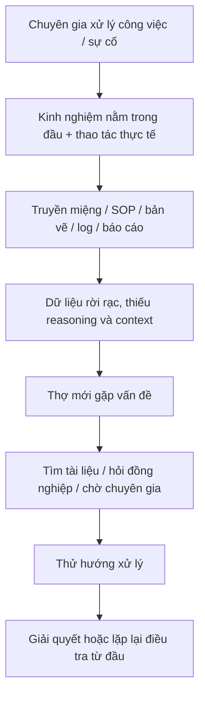
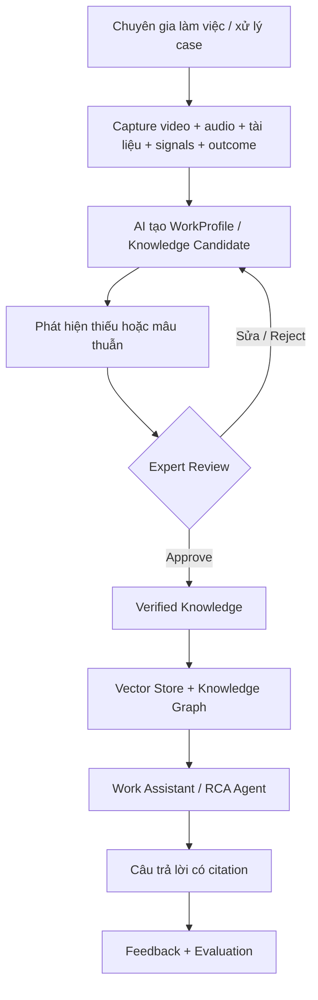

# Mentor Mind Know-How AI — Business Requirements Document

| Hạng mục | Nội dung |
| :--- | :--- |
| **Document ID** | `MENTORMIND/BRD/1.1` |
| **Document Name** | `Mentor Mind Know-How AI — Business Requirements Document` |
| **Project** | DENSO Factory Hacks 2026 — *Accumulate Master Know-How for AI to Learn* |
| **Owner** | Đạt — PM/BA |
| **Reviewer** | Việt Hoàng / Trung |
| **Status** | Draft for team review |
| **Creation Date** | `2026/09/26` |
| **Version** | `1.1` |
| **Target MVP** | `2026/10/12` |

---

## Lịch sử cập nhật

| Version | Date | Nội dung cập nhật | Người cập nhật |
| :---: | :---: | :--- | :--- |
| 1.0 | 2026/09/26 | Tạo BRD từ product overview, architecture, constitution, evaluation spec và thông tin thu thập từ DENSO/factory tour. | Đạt |

---

## Tài liệu liên quan

- [Product Overview](./00-product-overview.md)
- [Architecture](./architecture.md)
- [Constitution](./constitution.md)
- [Document Ingest & OCR](./02-document-ingest-ocr.md)
- [Video Capture & Segmentation](./03-video-capture-segmentation.md)
- [VLM Step Description](./04-vlm-step-description.md)
- [Knowledge Graph & GraphRAG](./05-knowledge-graph-graphrag.md)
- [Agents](./06-agents.md)
- [Sigma Adapter](./07-sigma-adapter.md)
- [API & UI](./08-api-and-ui.md)
- [Evaluation](./09-evaluation.md)
- [PRD](./PRD.md)

---

## 1. Executive Summary

### 1.1 Mục đích tài liệu

BRD này định nghĩa **bài toán nghiệp vụ, mục tiêu, phạm vi, quy tắc, dữ liệu và tiêu chí thành công** cho MVP Mentor Mind. Đây là nguồn tham chiếu để PRD và các đặc tả kỹ thuật phía sau triển khai thống nhất.

### 1.2 Tóm tắt giải pháp

Mentor Mind là giải pháp nhằm **ghi lại, xác minh và tái sử dụng bí quyết chuyên gia theo từng công đoạn sản xuất** mà không yêu cầu chuyên gia phải tự viết tài liệu thủ công.

Bài toán không chỉ là lưu lại *chuyên gia đã làm gì*, mà còn phải bảo tồn được:

1. **Action — Cái tay làm:** thao tác, thứ tự, thời lượng, hướng/góc/vị trí, lực/mô-men nếu có.
2. **Reason — Cái đầu nghĩ:** vì sao chuyên gia chọn thao tác đó, dấu hiệu nào khiến họ ra quyết định, điều kiện áp dụng và ngoại lệ.
3. **Signals — Cái chuyên gia đang đọc:** sensor, kết quả đo, âm thanh máy, ảnh bề mặt, bản vẽ/SOP, log hoặc tín hiệu khác tại đúng thời điểm ra quyết định.
4. **Outcome — Kết quả/hệ quả:** sản phẩm đạt/không đạt, máy chạy lại được hay không, lỗi có tái phát không, hành động xử lý có hiệu quả không.

AI chỉ tạo **bản nháp tri thức**. Chuyên gia là người xác minh, sửa hoặc từ chối. Chỉ tri thức đã được duyệt mới được đưa vào Knowledge Base và dùng để hỗ trợ thợ mới/QC/tổ trưởng.

---

## 2. Business Context

### 2.1 Bối cảnh

Trong sản xuất, một phần know-how quan trọng nằm trong kinh nghiệm cá nhân của chuyên gia và không được ghi đầy đủ trong SOP, bản vẽ hoặc tài liệu hướng dẫn. Khi chuyên gia chuyển vị trí, nghỉ việc hoặc nghỉ hưu, tri thức này có nguy cơ rời khỏi nhà máy cùng họ.

Các tài liệu hiện hữu có thể mô tả quy trình chuẩn, nhưng thường thiếu:

- lý do đằng sau một thao tác;
- dấu hiệu chuyên gia dùng để ra quyết định;
- thứ tự ưu tiên kiểm tra;
- trường hợp ngoại lệ;
- điều kiện thực tế khiến chuyên gia làm khác SOP;
- kết quả sau khi áp dụng cách xử lý.

DENSO cũng đã làm rõ rằng các loại dữ liệu khác nhau ghi lại các phần khác nhau của kinh nghiệm: video ghi được thao tác nhưng không tự nói lên lý do; reasoning thường phải đến từ audio/think-aloud/phỏng vấn; tín hiệu máy phải được đồng bộ đúng thời điểm; outcome giúp biến một bản ghi thành bài học đã được kiểm chứng.

### 2.2 Cơ hội kinh doanh/nghiệp vụ

Nếu capture đúng và đủ, tri thức chuyên gia có thể được:

- bảo tồn khi chuyên gia rời vị trí;
- tái sử dụng cho đào tạo thợ mới;
- truy vấn nhanh tại trạm làm việc;
- dùng làm căn cứ khi truy nguyên lỗi;
- liên kết với dữ liệu sản xuất để hỗ trợ quyết định;
- ghi nhận đúng nguồn đóng góp của chuyên gia.

---

## 3. Business Problem Statement

Hiện tại, DENSO có rủi ro **mất hoặc phân mảnh know-how chuyên gia** do tri thức nằm rải rác trong thao tác thực tế, lời giải thích, SOP, bản vẽ, dữ liệu máy và kinh nghiệm cá nhân.

Việc yêu cầu chuyên gia tự viết lại tri thức thủ công:

- tốn thời gian;
- khó capture được reasoning và ngoại lệ;
- dễ thiếu context tại thời điểm ra quyết định;
- khó duy trì khi quy trình thay đổi;
- không tạo được một nguồn tri thức có thể truy xuất và kiểm chứng thống nhất.

---

## 4. Business Objectives

### BO-01 — Preserve Expert Know-How
Số hóa bí quyết chuyên gia theo từng công đoạn trước khi tri thức bị thất thoát.

### BO-02 — Capture More Than SOP
Ghi lại đủ 4 lớp **Action + Reason + Signals + Outcome**, thay vì chỉ mô tả thao tác.

### BO-03 — Respect and Recognize Experts
Mọi tri thức phải giữ nguồn đóng góp, người xác minh và lịch sử chỉnh sửa; chuyên gia là người duyệt chứ không bị xem như nguồn dữ liệu bị khai thác thụ động.

### BO-04 — Reuse Knowledge at Work
Cho phép thợ mới/QC/tổ trưởng tìm lại hướng dẫn, lý do, ngoại lệ và bằng chứng liên quan ngay tại công đoạn.

### BO-05 — Build Verifiable Knowledge
AI không tự quyết. Chỉ tri thức được chuyên gia xác minh mới được dùng làm nguồn trả lời chính thức.

### BO-06 — Measure Usefulness
Đánh giá hệ thống bằng chất lượng capture/retrieval và hiệu quả nghiệp vụ, không chỉ bằng benchmark model.

---

## 5. Stakeholders & Personas

| Stakeholder / Persona | Nhu cầu chính | Giá trị nhận được |
|---|---|---|
| **Chuyên gia / thợ lành nghề** | Chia sẻ know-how bằng thao tác + lời nói, không phải viết dài | Được ghi nhận nguồn đóng góp; giảm công sức tài liệu hóa |
| **Thợ mới** | Biết “làm thế nào” và “vì sao” tại đúng công đoạn | Học nhanh hơn, giảm phụ thuộc vào việc hỏi đúng người |
| **QC / Tổ trưởng** | Truy nguyên case lỗi về công đoạn/thao tác/tri thức liên quan | Có bằng chứng và case tương tự để điều tra |
| **PM/BA** | Chốt input/output/ground truth/KPI | Có baseline và tiêu chí chấp nhận rõ |
| **DENSO IT / Security** | Bảo vệ dữ liệu nhà máy | Dữ liệu confidential không bị gửi ra cloud trái chính sách |
| **Hackathon judges / mentors** | Demo được end-to-end và đo được | Thấy rõ pain point, output và giá trị thực tế |

---

## 6. Current State (Before Improvement)

### Pain points
- Phụ thuộc cá nhân.
- Reasoning và ngoại lệ khó được ghi lại.
- Dữ liệu từ nhiều nguồn không liên kết theo cùng case/timestamp.
- Khó biết nguồn tri thức nào đã được xác minh.
- Khó đo mức độ hữu ích của tri thức sau khi lưu.

---

## 7. Future State (After Improvement)

---

## 8. Business Scope

### 8.1 In Scope — MVP

MVP tập trung vào **một công đoạn demo duy nhất: xếp linh kiện vào hộp (kitting/packing), process `PACK01`**.

Bao gồm:

- ingest video thao tác;
- transcript/audio reasoning nếu có;
- ingest SOP/bản vẽ/tài liệu mẫu;
- tạo WorkProfile nháp;
- expert review: approve / reject / edit;
- chỉ index profile đã approved;
- truy vấn bằng Work Assistant có citation;
- mock Sigma để demo RCA;
- evaluation trên golden set;
- dữ liệu MVP chỉ dùng `public` hoặc `synthetic`.

### 8.2 Out of Scope — MVP

- tích hợp Sigma thật;
- camera AI nhà máy thật;
- dữ liệu DENSO confidential thật nếu chưa được phê duyệt;
- xác thực/SSO người dùng;
- production deployment;
- huấn luyện robot bắt chước chuyên gia;
- tự động suy đoán `reason` nếu không có phát ngôn/bằng chứng chuyên gia.

---

## 9. Business Rules

### BR-01 — Expert Verification Is Mandatory
Mọi tri thức AI sinh ra bắt đầu ở trạng thái `draft`. Chỉ `approved` mới được index và dùng làm tri thức chính thức.

### BR-02 — Reason Must Come From Expert Evidence
Trường `reason` chỉ được điền từ lời chuyên gia/phỏng vấn/think-aloud đã capture. Không cho VLM tự bịa lý do từ video câm.

### BR-03 — Evidence & Attribution Are Required
Mỗi tri thức phải truy được về nguồn: profile/document/video segment/case; giữ thông tin người đóng góp/xác minh khi có.

### BR-04 — Confidential Data Must Stay Local
Dữ liệu `factory_confidential` không được gửi tới provider cloud.

### BR-05 — Missing Evidence Must Lead to Refusal or Review
Nếu bằng chứng không đủ mạnh, trợ lý phải từ chối hoặc đưa case vào review thay vì trả lời chắc chắn.

### BR-06 — Data Must Be Case/Time Linkable
Khi có nhiều modality, dữ liệu phải liên kết được bằng `case_id`, `process_id`, `timestamp` hoặc metadata tương đương để biết tín hiệu nào dẫn đến quyết định nào.

### BR-07 — Recognition Is Part of Knowledge Governance
Hệ thống phải giữ `contributor/reviewer/source` để tri thức được ghi nhận về đúng chuyên gia/người xác minh.

---

## 10. Business Data Requirements

Một case lý tưởng nên có tối đa 4 lớp dữ liệu:

| Lớp | Ví dụ | Mục đích |
|---|---|---|
| **Action** | video nhiều góc, keyframe, thời lượng, quỹ đạo | Biết expert làm gì |
| **Reason** | think-aloud, audio review, phỏng vấn, ghi chú | Biết tại sao expert làm vậy |
| **Signals** | sensor, kết quả đo, âm thanh máy, ảnh bề mặt, SOP/design/log | Biết expert đang dựa vào gì |
| **Outcome** | pass/fail, máy chạy lại, có tái phát không | Kiểm chứng cách xử lý |

MVP không bắt buộc mọi case có đủ 4 lớp, nhưng phải thể hiện rõ phần nào có/không có và không được suy diễn phần thiếu.

---

## 11. Business Success Metrics

### MVP metrics

| Metric | Ý nghĩa | Target MVP |
|---|---|---:|
| End-to-end demo success | Demo chạy trọn flow | 100% trong demo chính |
| Expert review outcome | Tỷ lệ approve không sửa / approve sau sửa / reject | Báo cáo đầy đủ |
| `reason_coverage.synthetic` | % profile approved synthetic có reason hợp lệ | ≥ 60% |
| Faithfulness | Câu trả lời bám nguồn | ≥ 0.85 |
| Answer relevancy | Câu trả lời đúng trọng tâm | ≥ 0.80 |
| Context precision | Context retrieve có liên quan | ≥ 0.70 |
| Context recall | Retrieve đủ context cần | ≥ 0.70 |
| Citation hit rate | Có citation đúng ground truth | Báo cáo |
| Refusal accuracy | Từ chối đúng khi out-of-scope | Báo cáo |

### Pilot metrics — sau MVP

- thời gian thợ mới hoàn thành công đoạn lần đầu;
- tỷ lệ lỗi trước/sau;
- thời gian tìm đúng know-how;
- thời gian điều tra một lot lỗi;
- Expert Acceptance Rate;
- Useful Rate;
- tỷ lệ tri thức có nguồn và được verify.

Không được bịa số pilot nếu chưa có dữ liệu thực tế.

---

## 12. Constraints

- Deadline MVP: 12/10/2026.
- Chưa có API Sigma thật.
- Chưa có camera AI/video nhà máy thật trong MVP.
- Dữ liệu confidential không được gửi cloud.
- Sample data phải đủ để chạy offline demo.
- Provider AI phải có khả năng hoán đổi giữa cloud/self-host.

---

## 13. Assumptions / TBD

Các mục dưới đây **chưa được nguồn hiện có xác nhận đầy đủ**, cần DENSO/BTC chốt:

1. DENSO có thể cung cấp sample data thật ở mức nào: video, audio, design, SOP, log, outcome?
2. Có chuyên gia thật tham gia ghi âm/duyệt sample trước ngày nộp không?
3. Chính sách benefit/recognition cho chuyên gia sẽ là monetary, Kaizen/recognition hay cơ chế khác?
4. Cách kết nối Sigma thật: API, DB hay file export?
5. Mức dữ liệu nào được phép dùng cloud, nếu có?
6. Deliverable BTC yêu cầu ngày 12/10 chính xác gồm slide/video/repo hay bộ nào?

---

## 14. Business Acceptance for MVP

MVP được xem là đáp ứng BRD khi:

1. Một case packing có thể đi từ raw sample → profile draft → expert review → approved knowledge → assistant answer có citation.
2. `reason` không được sinh từ video câm khi thiếu expert verbal evidence.
3. Dữ liệu confidential bị chặn khỏi cloud bằng code.
4. Có golden set và báo cáo evaluation tự sinh.
5. Demo giải thích được rõ: **Input là gì → Output là gì → ai xác minh → đo bằng gì**.

---

## 15. Traceability to Existing Specs

| Business need | Spec hiện tại |
|---|---|
| Document/SOP/design ingestion | `02-document-ingest-ocr.md` |
| Video/audio capture | `03-video-capture-segmentation.md` |
| VLM tạo profile | `04-vlm-step-description.md` |
| KB Vector + Graph | `05-knowledge-graph-graphrag.md` |
| Work Assistant / RCA | `06-agents.md` |
| Sigma mock | `07-sigma-adapter.md` |
| Expert review UI | `08-api-and-ui.md` |
| Evaluation | `09-evaluation.md` |

---

## 16. Changelog

| Version | Date | Nội dung |
| :---: | :---: | :--- |
| 1.0 | 2026/09/26 | Tạo BRD ban đầu. |
| 1.1 | 2026/09/26 | Cập nhật format theo chuẩn DD; nội dung nghiệp vụ giữ nguyên. |
