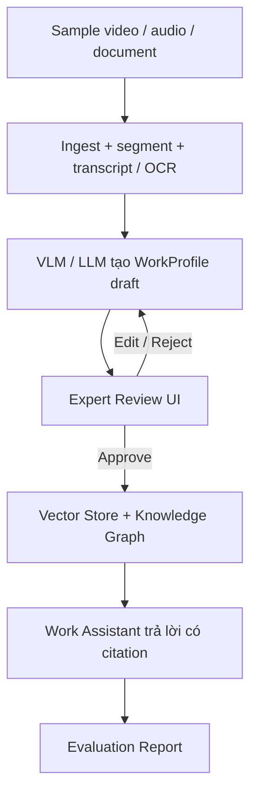

# Mentor Mind Know-How AI — Product Requirements Document

| Hạng mục | Nội dung |
| :--- | :--- |
| **Document ID** | `MENTORMIND/PRD/1.1` |
| **Document Name** | `Mentor Mind Know-How AI — Product Requirements Document` |
| **Project** | DENSO Factory Hacks 2026 — *Accumulate Master Know-How for AI to Learn* |
| **Owner** | Đạt — PM/BA |
| **Reviewer** | Việt Hoàng / Trung |
| **Status** | Draft for implementation review |
| **Creation Date** | `2026/09/26` |
| **Version** | `1.1` |
| **Target MVP** | `2026/10/12` |

---

## Lịch sử cập nhật

| Version | Date | Nội dung cập nhật | Người cập nhật |
| :---: | :---: | :--- | :--- |
| 1.0 | 2026/09/26 | Tạo PRD từ BRD, product overview, constitution và specs 02–09. | Đạt |

---

## Tài liệu liên quan

- [BRD](./BRD.md)
- [Product Overview](./00-product-overview.md)
- [Architecture](./architecture.md)
- [Constitution](./constitution.md)
- [Document Ingest & OCR](./02-document-ingest-ocr.md)
- [Video Capture & Segmentation](./03-video-capture-segmentation.md)
- [VLM Step Description](./04-vlm-step-description.md)
- [Knowledge Graph & GraphRAG](./05-knowledge-graph-graphrag.md)
- [Agents](./06-agents.md)
- [Sigma Adapter](./07-sigma-adapter.md)
- [API & UI](./08-api-and-ui.md)
- [Evaluation](./09-evaluation.md)

---

## 1. Product Vision

### 1.1 Mục đích tài liệu

PRD này chuyển các yêu cầu nghiệp vụ trong BRD thành **phạm vi sản phẩm, user story, functional requirement, data contract, acceptance criteria và traceability** để team kỹ thuật triển khai MVP thống nhất.

### 1.2 Tầm nhìn sản phẩm

Mentor Mind biến dữ liệu về cách chuyên gia làm việc thành **Verified Knowledge** có thể được tìm kiếm, truy xuất và tái sử dụng tại nhà máy.

Sản phẩm không chỉ hỏi “expert đã làm gì?” mà phải giữ được, khi có bằng chứng:

- **Action:** thao tác và thứ tự;
- **Reason:** lý do/cách suy luận;
- **Signals:** dữ liệu expert dựa vào;
- **Outcome:** kết quả sau xử lý;
- **Evidence:** nguồn/timestamp;
- **Attribution:** ai đóng góp/xác minh.

AI tạo bản nháp. Chuyên gia là người quyết định tri thức nào được publish.

---

### 1.3 MVP Product Goal

Trong ≤ 5 phút demo, hệ thống phải chứng minh được luồng:



Công đoạn MVP: **PACK01 — xếp linh kiện vào hộp (kitting/packing)**.

---

## 2. Personas & User Stories

### P1 — Chuyên gia / thợ lành nghề

**US-01**  
Là chuyên gia, tôi muốn hệ thống ghi lại thao tác và lời giải thích của tôi để tôi không phải viết lại tài liệu thủ công.

**US-02**  
Là chuyên gia, tôi muốn xem, sửa, approve hoặc reject tri thức AI tạo ra trước khi nó được dùng chính thức.

**US-03**  
Là chuyên gia, tôi muốn phần know-how được ghi nhận nguồn đóng góp/xác minh của tôi.

### P2 — Thợ mới

**US-04**  
Là thợ mới, tôi muốn hỏi “bước này làm thế nào?” và nhận câu trả lời có source/video/document liên quan.

**US-05**  
Là thợ mới, tôi muốn biết “vì sao phải làm như vậy?” nếu reason đã được chuyên gia xác minh.

**US-06**  
Khi hệ thống không đủ evidence, tôi muốn nó nói không biết/tham chiếu chuyên gia thay vì bịa.

### P3 — QC / Tổ trưởng

**US-07**  
Là QC/tổ trưởng, tôi muốn truy từ lot/lỗi sang công đoạn, thao tác và nguyên nhân khả dĩ để hỗ trợ điều tra.

### P4 — PM/BA / Evaluator

**US-08**  
Tôi muốn có golden set, ground truth và báo cáo metric để biết phiên bản nào tốt hơn.

---

## 3. Product Scope & Priorities

| Priority | Ý nghĩa | Mục tiêu |
| :---: | :--- | :--- |
| **Must** | Bắt buộc cho MVP | Luồng capture → verify → retrieve → answer → evaluate chạy end-to-end |
| **Should** | Nên có | Tăng độ tin cậy của reason, review và evaluation |
| **Could** | Có thể bổ sung | Mở rộng demo hoặc roadmap nếu còn thời gian |
| **Won't** | Không làm trong MVP | Giữ scope gọn, tránh lệch sang production integration |

### Must

- Ingest PDF/DOCX/XLSX/bản vẽ.
- Ingest video sample và cắt segment/keyframe.
- Transcript audio/commentary có timestamp.
- VLM sinh WorkProfile draft theo schema.
- Expert review: edit / approve / reject.
- Chỉ approved profile mới được index.
- Hybrid retrieval qua Vector + Graph.
- Work Assistant trả lời có citation.
- Offline demo trên synthetic/public data.
- Golden set + evaluation report.

### Should

- Gắn expert verbal reason vào profile theo timestamp.
- Detect/flag thiếu reason hoặc confidence thấp để review.
- Mock Sigma cho RCA demo.
- FPS sweep và key-point recall.

### Could

- Multi-angle video.
- Signal/sensor mock đồng bộ timestamp.
- Expert contribution dashboard.
- Self-host VLM trên GPU/RunPod cho demo non-confidential.
- A3/8D export.

### Won't — MVP

- Production deployment.
- Real Sigma integration.
- Real factory confidential video.
- Full authentication/SSO.
- Train robot imitation model.
- VLM tự suy luận reason từ video câm.

---

## 4. Product Data Contract

### 5.1 Case-level concept

Mỗi sample case nên có một `case_id` và tối đa 4 lớp dữ liệu:

```text
case_id
├── Action
├── Reason
├── Signals
└── Outcome
```

Không bắt buộc mọi layer đều tồn tại. Trường thiếu phải được biểu diễn là `null/unknown`, không suy diễn.

### 5.2 Recommended sample folder

```text
data/samples/packing/case_001/
├── metadata.json
├── action/
│   ├── video_main.mp4
│   └── video_alt.mp4              # optional
├── reasoning/
│   ├── think_aloud.wav            # optional
│   └── expert_notes.txt           # optional
├── signals/
│   ├── sensor.csv                 # optional
│   ├── measurement.csv            # optional
│   └── surface_image.jpg          # optional
├── documents/
│   ├── sop.pdf                    # optional
│   └── drawing.pdf                # optional
├── outcome/
│   └── result.json
└── expected/
    └── work_profile.json
```

### 5.3 `metadata.json`

```json
{
  "case_id": "CASE-PACK01-001",
  "process_id": "PACK01",
  "title": "Xếp linh kiện A vào hộp",
  "data_classification": "synthetic",
  "expert_id": "EXP-DEMO-01",
  "capture_start": "2026-09-26T10:00:00+07:00",
  "notes": "Synthetic demo case"
}
```

### 5.4 Expected WorkProfile — ground truth

Ground truth do BA gán tay và reviewer kiểm tra, dùng để benchmark extraction.

```json
{
  "profile_id": "WP-PACK01-003",
  "process_id": "PACK01",
  "step_order": 3,
  "step": "Đặt linh kiện A vào ngăn trái",
  "hand_action": "Cầm linh kiện bằng hai ngón và đặt vào ngăn trái",
  "key_point": "Chân linh kiện hướng ra ngoài",
  "reason": "Tránh chân linh kiện va vào thành hộp khi đóng nắp",
  "reason_source": "expert_verbal",
  "exceptions": [
    {
      "case": "Chân linh kiện bị cong",
      "handling": "Không đóng gói, chuyển QC kiểm tra"
    }
  ],
  "pass_criteria": "Linh kiện đúng ngăn và đúng chiều",
  "status": "approved",
  "data_classification": "synthetic"
}
```

> Field names cuối cùng phải khớp schema Pydantic hiện hành của repo; JSON trên là business-level expected output.

---

## 5. Functional Requirements — Product Level

### 5.1 Danh sách yêu cầu chức năng

| ID | Yêu cầu | Output chính | Spec liên quan |
| :--- | :--- | :--- | :--- |
| PRD-FR-01 | Ingest document evidence | `DocumentChunk[]` | 02 |
| PRD-FR-02 | Ingest & segment video evidence | Segment + keyframe + transcript | 03 |
| PRD-FR-03 | Capture expert verbal reasoning | `reason` + source | 03, 04 |
| PRD-FR-04 | Generate WorkProfile draft | `WorkProfile(status=draft)` | 04 |
| PRD-FR-05 | Human expert verification | Versioned profile + review event | 08 |
| PRD-FR-06 | Publish verified knowledge only | Searchable verified knowledge | 05, 08 |
| PRD-FR-07 | Retrieve knowledge with evidence | Retrieval result + citation | 05 |
| PRD-FR-08 | Work Assistant with citation/refusal | `AssistantAnswer` | 06 |
| PRD-FR-09 | RCA demo from mock Sigma | `RcaReport` | 06, 07 |
| PRD-FR-10 | Data protection gate | Allow / block | Constitution, 02–06 |
| PRD-FR-11 | Attribution & contribution metadata | Contributor / reviewer / source | 05, 08 |
| PRD-FR-12 | Evaluation & reproducibility | Evaluation report | 09 |

### 5.2 Chi tiết yêu cầu chức năng

### PRD-FR-01 — Ingest document evidence

**Input:** PDF/DOCX/XLSX/PPTX/bản vẽ.  
**System behavior:** trích text/table/drawing note + metadata + classification.  
**Output:** `DocumentChunk[]`.  
**Mapped spec:** 02.

**Acceptance:** Sample document hợp lệ không được tạo 0 chunk; bảng phải giữ cấu trúc; source/classification phải truy được.

---

### PRD-FR-02 — Ingest and segment video evidence

**Input:** video thao tác sample.  
**System behavior:** lưu video asset, segment hợp lý, sinh keyframe, transcript nếu có lời.  
**Output:** video/segment records có `t_start`, `t_end`, evidence reference.  
**Mapped spec:** 03.

**Acceptance:** Video demo phải tạo ≥ 1 segment; timestamp không âm/lệch thứ tự; segment phải trỏ được về source video.

---

### PRD-FR-03 — Capture expert verbal reasoning

**Input:** think-aloud/audio review/interview/transcript.  
**System behavior:** trích nguyên ý expert liên quan tới reason; liên kết theo timestamp/case.  
**Output:** `reason` + `reason_source="expert_verbal"` hoặc để null.  
**Mapped spec:** 03, 04.

**Acceptance:** Không có expert verbal evidence → `reason` phải null. Reason không khớp transcript → reject reason.

---

### PRD-FR-04 — Generate WorkProfile draft

**Input:** segment/keyframe + available document/transcript evidence.  
**System behavior:** VLM/LLM chỉ mô tả điều có evidence, sinh step/action/key point/exception/pass criteria theo schema.  
**Output:** `WorkProfile(status="draft")`.  
**Mapped spec:** 04.

**Acceptance:** Không bịa reason; step order liên tục; invalid JSON/schema phải bị repair hoặc fail có log.

---

### PRD-FR-05 — Human expert verification

**Input:** WorkProfile draft/in_review.  
**System behavior:** expert xem clip/keyframe/source, edit, approve hoặc reject.  
**Output:** versioned profile + review event.  
**Mapped spec:** 08.

**Acceptance:** Reject bắt buộc lý do; sửa profile tăng version; profile chưa approved không được coi là verified knowledge.

---

### PRD-FR-06 — Publish only verified knowledge

**Input:** approved WorkProfile.  
**System behavior:** index approved knowledge vào vector index của hệ thống (current implementation: PostgreSQL + pgvector) và đồng bộ vào Knowledge Graph. Rejected/unapproved knowledge không được đưa vào nguồn retrieval chính thức.
**Output:** searchable verified knowledge.  
**Mapped spec:** 05, 08.

**Acceptance:** Draft/rejected profile không xuất hiện trong retrieval chính thức.

---

### PRD-FR-07 — Retrieve knowledge with evidence

**Input:** câu hỏi user + optional process id.  
**System behavior:** hybrid retrieval Vector + Graph, trả passage/profile có score và citation.  
**Output:** retrieval result có source reference.  
**Mapped spec:** 05.

**Acceptance:** Golden question phải retrieve được expected citation theo ngưỡng evaluation.

---

### PRD-FR-08 — Work Assistant with citation and refusal

**Input:** câu hỏi như “Bước này làm thế nào?”, “Vì sao?”, “Có ngoại lệ không?”.  
**System behavior:** trả lời chỉ từ retrieved evidence; cite nguồn; nếu không đủ evidence thì refused.  
**Output:** `AssistantAnswer`.  
**Mapped spec:** 06.

**Acceptance:** Không citation hợp lệ → regenerate 1 lần, vẫn không có → refused.

---

### PRD-FR-09 — RCA demo from mock Sigma

**Input:** lot/symptom mock.  
**System behavior:** kết hợp Sigma mock + graph + retrieval để sinh tối đa 3 hypothesis + 3–5 Why.  
**Output:** `RcaReport`.  
**Mapped spec:** 06, 07.

**Acceptance:** Why không có evidence phải `verified=false`; report luôn có disclaimer.

---

### PRD-FR-10 — Data protection gate

**Input:** mọi source/request trước khi gọi provider.  
**System behavior:** kiểm `data_classification` và `provider.is_cloud`.  
**Output:** allow hoặc `ConfidentialDataError`.  
**Mapped spec:** constitution, 02–06.

**Acceptance:** `factory_confidential` + cloud → chặn trước khi file/context bị gửi.

---

### PRD-FR-11 — Attribution & contribution metadata

**Input:** expert_id / reviewer / source references nếu có.  
**System behavior:** lưu contributor/reviewer/source trên profile/review history.  
**Output:** tri thức truy được nguồn đóng góp.  
**Mapped spec:** 05, 08.

**Acceptance:** Profile approved phải truy ra reviewer; answer citation phải truy ra source profile/document/video.

---

### PRD-FR-12 — Evaluation and reproducibility

**Input:** golden set + approved profiles + traces.  
**System behavior:** chạy Ragas + metric tự tính + review stats; lưu run metadata.  
**Output:** CSV/JSON/Markdown usefulness report.  
**Mapped spec:** 09.

**Acceptance:** Report có metric, pass/fail threshold, 5 câu tệ nhất, profile cần xem lại, model + commit hash.

---

## 6. Sample Data Requirements — BA Deliverable

BA phải chuẩn bị sample data đủ để kỹ thuật không phải tự đoán output đúng.

### Minimum sample package cho MVP

- **3–5 packing cases**.
- Ít nhất 1 case có video + expert reason audio.
- Ít nhất 1 case video câm → expected `reason=null`.
- Ít nhất 1 case có exception.
- Ít nhất 1 case confidence thấp hoặc input mơ hồ → cần review.
- Ít nhất 1 case có document/SOP liên quan.
- Nếu có signal/outcome mock, phải dùng cùng `case_id` và timeline.

### Sample case categories

| Case | Input | Expected product behavior |
|---|---|---|
| C1 — Full evidence | video + audio + doc | sinh profile gần đầy đủ |
| C2 — Silent video | video câm | action/key point có thể có; `reason=null` |
| C3 — Exception | video/audio có ngoại lệ | populate `exceptions` |
| C4 — Ambiguous | hình/step không rõ | confidence thấp / expert review |
| C5 — Conflict | expert nói hoặc doc mâu thuẫn với observed step | không auto-publish; review |

---

## 7. Golden Set Requirements

File: `data/golden_set/qa.jsonl`.

Tối thiểu 30 câu theo spec 09:

- how: 10;
- why: 6;
- exception: 5;
- relational: 5;
- out_of_scope: 4.

Mỗi câu cần:

```json
{
  "qid": "Q001",
  "process_id": "PACK01",
  "type": "why",
  "question": "Vì sao phải đặt linh kiện A nghiêng?",
  "ground_truth": "Để tránh trầy bề mặt khi đóng nắp.",
  "expected_citations": ["WP-PACK01-003"],
  "author": "Đạt",
  "created_at": "2026-09-30"
}
```

Ground truth phải do BA tạo và reviewer kiểm tra; không được dùng output model làm ground truth của chính model đó.

---

## 8. Non-Functional Requirements

### NFR-01 — Security
`factory_confidential` không rời khỏi local/self-host environment.

### NFR-02 — Auditability
Mọi answer/profile phải có evidence/citation/review history khi applicable.

### NFR-03 — Replaceable providers
OCR/LLM/VLM/vector store phải nằm sau interface/config, không hardcode provider.

### NFR-04 — Reproducibility
Evaluation ghi run_id, model, timestamp, commit hash.

### NFR-05 — Demo reliability
`make demo` offline phải chạy trên máy sạch, không phụ thuộc network/API key.

### NFR-06 — UI usability
UI tablet tiếng Việt, chữ ≥16px, nút lớn, expert review không yêu cầu thao tác kỹ thuật phức tạp.

### NFR-07 — Response grounding
Không đủ evidence → refusal thay vì hallucination.

---

## 9. Product Metrics

### Extraction / Capture
- step recall;
- precision;
- order accuracy;
- key-point recall;
- reason coverage;
- approve without edit / approve after edit / reject;
- error tag distribution.

### Retrieval / Answer
- faithfulness ≥ 0.85;
- answer relevancy ≥ 0.80;
- context precision ≥ 0.70;
- context recall ≥ 0.70;
- citation hit rate;
- refusal accuracy.

### Pilot business metrics
- time to find know-how;
- time for new worker to complete first run;
- error rate;
- RCA investigation time;
- Expert Acceptance Rate;
- Useful Rate.

---

## 10. UX / Main Screens

### Screen 1 — Duyệt thao tác

Expert xem:
- 3 keyframes;
- clip segment;
- step;
- hand action;
- key point;
- reason + reason source;
- exceptions;
- pass criteria;
- source evidence.

Actions:
- Edit;
- Approve;
- Reject + comment/error tags.

### Screen 2 — Hỏi trợ lý

Worker:
- chọn process;
- nhập câu hỏi;
- nhận answer + citation;
- click citation xem source.

### Screen 3 — Truy nguyên lỗi

QC:
- chọn lot/mock symptom;
- xem hypothesis;
- evidence;
- 5-Why verified/unverified;
- prevention profile;
- disclaimer.

---

## 11. End-to-End Demo Scenario

### Demo input

- `packing_demo_01.mp4` — synthetic video;
- `expert_comment_01.wav` — expert-style synthetic narration;
- `packing_sop.pdf` — synthetic SOP;
- mock Sigma CSV;
- expected WorkProfile + golden QA.

### Demo flow

1. Upload/process video + document.
2. System creates draft profile.
3. Reviewer edits/approves on UI.
4. Approved profile enters KB.
5. Ask “Bước này làm thế nào?” → answer with citation.
6. Ask “Vì sao?” → answer only if verified reason exists.
7. Ask out-of-scope question → refusal.
8. Run RCA sample from mock lot.
9. Show evaluation report.

---

## 12. Product-Level Acceptance Criteria

### PRD-AC-01
`make demo` offline chạy end-to-end thành công.

### PRD-AC-02
Silent-video case không sinh `reason`.

### PRD-AC-03
Approved profile searchable; draft/rejected không searchable như verified knowledge.

### PRD-AC-04
Assistant answer có citation hợp lệ; thiếu evidence → refused.

### PRD-AC-05
Factory confidential source bị DataGuard chặn khỏi cloud.

### PRD-AC-06
Golden set evaluation report sinh đủ metric và run metadata.

### PRD-AC-07
Attribution/reviewer của approved knowledge truy được từ UI/API/profile history.

### PRD-AC-08
Một case sample có thể trace từ raw input → segment/chunk → profile → citation → answer.

---

## 13. Traceability Matrix

| Product FR | Existing spec/module | Owner chính |
|---|---|---|
| PRD-FR-01 | Spec 02 | Việt Hoàng |
| PRD-FR-02 | Spec 03 | Việt Hoàng |
| PRD-FR-03 | Spec 03/04 | Việt Hoàng / Phúc |
| PRD-FR-04 | Spec 04 | Phúc |
| PRD-FR-05 | Spec 08 | Vinh |
| PRD-FR-06 | Spec 05/08 | Việt Hoàng / Vinh |
| PRD-FR-07 | Spec 05 | Việt Hoàng |
| PRD-FR-08 | Spec 06 | Phúc |
| PRD-FR-09 | Spec 06/07 | Phúc / Vinh |
| PRD-FR-10 | Constitution/DataGuard | Toàn team |
| PRD-FR-11 | Spec 05/08 | Vinh / Việt Hoàng |
| PRD-FR-12 | Spec 09 | Đạt / Phúc |

---

## 14. Open Questions / Decisions Needed

1. Sample thật nào DENSO có thể chia sẻ sau khi ẩn dữ liệu nhạy cảm?
2. Có expert thật review ít nhất một case trước submission không?
3. Có cần sample bản design thật hay synthetic drawing là đủ cho MVP?
4. Có cần signal/outcome mock trong demo 12/10 hay để pilot?
5. Có triển khai expert benefit/recognition trong MVP UI hay chỉ trình bày roadmap?
6. Chọn GPU/self-host provider nào cho VLM demo; phần này không được làm thay đổi business logic.

---

## 15. Changelog

| Version | Date | Nội dung |
| :---: | :---: | :--- |
| 1.0 | 2026/09/26 | Tạo PRD ban đầu từ BRD và các spec 02–09. |
| 1.1 | 2026/09/26 | Cập nhật format theo chuẩn DD; logic sản phẩm giữ nguyên. |

