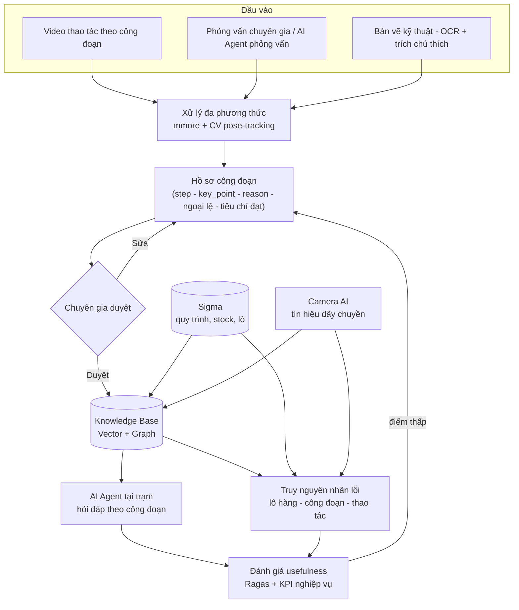

# Kiến trúc hệ thống — Mentor Mind

> Accumulate Master Know-How for AI to Learn · Denso Hackathon
> Tài liệu này mô tả kiến trúc kỹ thuật đầy đủ: các lớp hệ thống, luồng dữ liệu, schema, lựa chọn công nghệ và lý do, ràng buộc hạ tầng, và ai trong đội sở hữu phần nào.

## 1. Nguyên tắc thiết kế

1. **Capture không xâm lấn** — thiết bị ghi lại thao tác ngay tại trạm làm việc, không đổi quy trình sản xuất.
2. **Chuyên gia là người duyệt, không phải người viết** — AI sinh nháp, chuyên gia xác nhận hoặc sửa; không nội dung nào vào knowledge base mà chưa qua duyệt.
3. **Không chỉ capture "cái gì", mà cả "vì sao"** — video chỉ cho thấy thao tác; lý do đằng sau (bí quyết thật sự) chỉ lấy được bằng lời giải thích của chuyên gia, thông qua cơ chế khuyến khích (benefit) khi họ chủ động chia sẻ.
4. **Hybrid retrieval, không chỉ vector** — vector store trả lời tốt câu hỏi mô tả tự do; knowledge graph trả lời tốt câu hỏi quan hệ ("lỗi này từng xảy ra ở máy nào khác"). Cần cả hai.
5. **Self-host cho dữ liệu thật** — video thao tác của nhà máy là bí quyết công nghệ, không đi qua API cloud của bên thứ ba. Chi tiết ở mục 8.
6. **Neo tri thức vào dữ liệu vận hành thật (Sigma, camera AI)** — knowledge base không đứng độc lập mà liên kết với hệ thống MES sẵn có, cho phép truy vết lô hàng – công đoạn – nguyên nhân.

## 2. Sơ đồ tổng thể



## 3. Các lớp hệ thống

### Lớp 1 — Capture

Ba nguồn đầu vào, ưu tiên theo chi phí thu thập:

| Nguồn                  | Công cụ                                       | Ghi chú                                                                                                           |
| ----------------------- | ----------------------------------------------- | ------------------------------------------------------------------------------------------------------------------ |
| Video thao tác         | Camera tại trạm, quay 3–5 phút/công đoạn | Ưu tiên video**có** lời bình luận (xem mục 4); nếu video câm, bắt buộc bổ sung video-cued recall |
| Phỏng vấn chuyên gia | LLM interview agent, kịch bản 5-Why           | Dùng khi video không đủ để suy ra "vì sao"                                                                  |
| Bản vẽ kỹ thuật     | OCR + trích chú thích (Docling/ColPali)      | Gắn linh kiện trong bản vẽ với vật thể trong video                                                          |

### Lớp 2 — Xử lý đa phương thức

- **mmore** (EPFL LiGHT, Apache 2.0): ingest PDF/Office/audio, chuẩn hóa thành text có cấu trúc. Chạy được cả CPU (ingest tài liệu, không cần GPU) và GPU (media file). *Không* tự sinh mô tả hành động từ video câm — chỉ trích transcript nếu có lời.
- **Pose-tracking + phân đoạn thao tác** (MediaPipe Hands + model chuỗi thời gian dạng CNN/BiLSTM+Attention): xác định ranh giới và loại thao tác (nhặt/xoay/đặt/kiểm tra) ở tần số cao, độc lập với VLM.
- **VLM mô tả thao tác** (Qwen3-VL, self-host): nhận đúng đoạn đã được pose-tracking cắt ranh giới, sinh mô tả bằng ngôn ngữ. Quy trình 3 lượt:

  1. *Phân đoạn* — chỉ trả ranh giới thời gian, không mô tả.
  2. *Mô tả từng đoạn* — cắt riêng 5–15 giây, ép JSON theo schema mục 5.
  3. *Tổng hợp* — gộp JSON, dựng task graph, phát hiện mâu thuẫn giữa nhiều video cùng công đoạn.

  Cấu hình khuyến nghị: model **Qwen3-VL-8B-Instruct** (cạnh tranh với bản Qwen2.5-VL-72B ở tác vụ video), chạy BF16 trên GPU 24GB (RTX 4090/3090/A10G/L4); lấy mẫu **4–8 fps** (không dùng mặc định 1 fps — mất động tác tay nhanh); độ phân giải khung hình *low* để ưu tiên độ dày thời gian hơn độ nét.

### Lớp 3 — Knowledge Base

- **Vector store** (PostgreSQL + pgvector): tìm theo mô tả tự do — hybrid dense (pgvector, HNSW cosine) + lexical (full-text `tsvector`), gộp bằng Reciprocal Rank Fusion.
- **Knowledge Graph** (Neo4j): quan hệ `Equipment –has→ Symptom –caused_by→ RootCause –fixed_by→ Procedure`, cộng `Expert` và `Shift` để truy vết. Bootstrap bằng Neo4j LLM Graph Builder, chuyên gia sửa quan hệ sai.
- **Tích hợp Sigma**: dùng mã công đoạn/sản phẩm của Sigma làm khóa liên kết hồ sơ công đoạn với dữ liệu vận hành thật (lô, ca, người, thời gian).
- **Tích hợp Camera AI**: tín hiệu dây chuyền làm metadata bổ sung (thời điểm, nhịp thao tác) khi video không có lời.

### Lớp 4 — AI Agent

Hai agent chuyên biệt (hẹp thì ít ảo giác hơn một chatbot vạn năng):

| Agent          | Việc                                                   | Nguồn dữ liệu |
| -------------- | ------------------------------------------------------- | ---------------- |
| Work Assistant | Hỏi-đáp tại trạm, luôn kèm nguồn trích dẫn    | Vector + Graph   |
| RCA Agent      | Dẫn dắt 5-Why, truy ca tương tự, xuất A3/8D nháp | Graph + Sigma    |

### Lớp 5 — Đánh giá

- **Kỹ thuật**: Ragas — faithfulness ≥ 0.85, answer relevancy ≥ 0.8.
- **Nghiệp vụ**: A/B test thợ mới có/không trợ lý — thời gian xử lý sự cố, tỷ lệ sửa đúng lần đầu.
- Điểm thấp ở bất kỳ vòng nào → quay lại sửa hồ sơ công đoạn (không đổi model trước).

## 4. Xử lý trường hợp video không lời

Video câm chỉ cho biết **cái gì / thế nào**, không cho biết **vì sao** — phần cốt lõi của know-how. Ba kỹ thuật bổ sung, xếp theo độ ưu tiên:

1. **Video-cued recall (khuyến nghị chính)**: chiếu lại video cho chuyên gia, ghi âm phần họ bình luận ("tôi xoay ngược vì nếu không sẽ trầy mặt"), gắn theo mốc thời gian của video.
2. **Vision model sinh nháp + chuyên gia duyệt**: VLM mô tả thao tác từ hình ảnh, chuyên gia chỉ sửa — không tự suy ra lý do.
3. **Gắn metadata Sigma/Camera AI**: xác định đúng công đoạn/sản phẩm cho video, dù không có lời.

Nếu chỉ có video câm và không thu được bình luận của chuyên gia, sản phẩm chỉ là "SOP mô tả thao tác", chưa phải "knowledge base chứa bí quyết" — điều kiện tiên quyết cần chốt với nhà máy từ đầu dự án.

## 5. Schema dữ liệu

### Hồ sơ công đoạn — `WorkProfile` (đơn vị dữ liệu gốc, không phải tài liệu)

Nguồn sự thật là contract [`contracts/work_profile.schema.json`](contracts/work_profile.schema.json) (v1.0). Ví dụ dưới đây là một profile **đã duyệt** hợp lệ theo contract; nếu hai bên lệch nhau, contract thắng.

```json
{
  "schema_version": "1.0",
  "profile_id": "WP-PACK01-003",
  "process_id": "PACK01",
  "step_order": 3,
  "step": "Đặt linh kiện A vào ngăn trái",
  "actor": "human",
  "hand_action": "tay phải nhặt, xoay 90 độ, đặt nghiêng",
  "objects": ["linh kiện A", "khay chia ngăn"],
  "key_point": "chân linh kiện hướng ra ngoài",
  "reason": "tránh trầy bề mặt khi đóng nắp hộp",
  "reason_source": "expert_verbal",
  "exceptions": [
    { "case": "thiếu 1 món", "handling": "báo quản lý ca, không tự thay thế" }
  ],
  "pass_criteria": "không có khe hở > 2mm giữa linh kiện và vách ngăn",
  "equipment_id": "SIGMA-EQ-2201",
  "part_numbers": ["A123"],
  "expert": { "expert_id": "EXP-001", "display_name": "Nguyễn Văn A" },
  "evidence": {
    "video_id": "VID-PACK01-0001",
    "t_start": 14.0,
    "t_end": 19.0,
    "segment_ids": ["VID-PACK01-0001#s03"],
    "keyframes": [],
    "transcript_excerpt": "tôi xoay ngược vì nếu không sẽ trầy mặt",
    "document_refs": []
  },
  "confidence": 0.82,
  "generated_by": "vlm",
  "model_info": { "provider": "local_openai", "model": "Qwen3-VL-8B-Instruct", "fps": 4 },
  "data_classification": "synthetic",
  "status": "approved",
  "review": {
    "reviewer": "EXP-001",
    "reviewed_at": "2026-09-25T09:30:00+07:00",
    "comment": null,
    "error_tags": []
  },
  "created_at": "2026-09-24T15:02:00+07:00",
  "version": 2
}
```

Ràng buộc chính (được contract kiểm tra qua `allOf`):

- `actor` cho biết ai làm bước: `human` (người: công nhân, kỹ sư), `robot` (robot có cánh tay), `machine` (máy tự động cố định), `null` = không rõ. Tên bước không ghi chủ thể. Bí quyết cần truyền lại nằm chủ yếu ở bước `human`; bước `robot`/`machine` là bối cảnh.
- `reason` là trường phân biệt dự án này với một SOP thông thường. Bản nháp VLM (`generated_by = "vlm"`, `status = "draft"`) **bắt buộc** có `reason = null` và `reason_source = null` — VLM không được tự điền lý do.
- Khi `reason` có giá trị thì phải có `reason_source ∈ {expert_verbal, expert_interview}` — tức lý do chỉ đến từ lời chuyên gia (video-cued recall hoặc phỏng vấn).
- `status = "approved"` bắt buộc có `review.reviewer` và `review.reviewed_at`.
- Thời gian trong `evidence` là số giây (`t_start`, `t_end`), không phải chuỗi `"mm:ss"`.

## 6. Cấu trúc thư mục repo

```
mentormind-knowhow-ai/
├── mentormind/              # TOÀN BỘ mã nguồn ứng dụng (package Python `mentormind`)
│   ├── core/                # config, CLI, Pydantic schemas, DataGuard — dùng chung (Trung)
│   ├── capture/             # ingest tài liệu/OCR, video: pose-tracking, phân đoạn thao tác (Hoàng)
│   ├── processing/          # VLM describe, task-graph (Phúc)
│   ├── knowledge_base/      # Neo4j, Postgres/pgvector, tích hợp Sigma, profile store (Vinh, Trung)
│   ├── agents/              # Work Assistant, RCA Agent (Phúc)
│   ├── evaluation/          # golden set, Ragas (Đạt + Phúc)
│   ├── backend/app/         # REST API FastAPI (Vinh)
│   └── frontend/            # UI tablet tại trạm
├── tests/                   # pytest, phản chiếu cấu trúc mentormind/
├── infra/                   # docker/ (gpu.Dockerfile, cpu.Dockerfile), postgres/init.sql
├── docs/                    # spec, contracts/, sơ đồ, evaluation plan (nguồn sự thật)
└── data/samples/            # CHỈ dataset công khai — không chứa video thật
```

## 7. Lựa chọn công nghệ và lý do

| Thành phần              | Lựa chọn               | Vì sao không chọn phương án khác                                                                                                                                                                            |
| ------------------------- | ------------------------ | ------------------------------------------------------------------------------------------------------------------------------------------------------------------------------------------------------------------ |
| Ingest đa phương thức | mmore                    | Xử lý PDF/Office/audio trong cùng một pipeline; open-source, Apache 2.0, tự host được                                                                                                                      |
| VLM mô tả thao tác     | Qwen3-VL-8B self-host    | Cạnh tranh với 72B ở video; có bản open-weight tự host — loại AWS Bedrock/Nova/TwelveLabs, Gemini API, Qwen API cloud vì đều là bên thứ ba, không đáp ứng yêu cầu self-host cho video thật    |
| Vector store              | PostgreSQL 16 + pgvector | Một container duy nhất (Milvus standalone cần thêm etcd + MinIO, ~5GB RAM); filter metadata bằng SQL thường; hybrid bằng pgvector + full-text Postgres; sau này có thể gộp profile store vào cùng DB |
| Knowledge Graph           | Neo4j                    | Chuẩn công nghiệp, có LLM Graph Builder bootstrap nhanh                                                                                                                                                        |
| Agent orchestration       | LangChain                | Giao diện sẵn có của mmore RAG, không cần viết retrieval layer riêng                                                                                                                                       |
| Đánh giá RAG           | Ragas                    | Có sẵn hướng tích hợp trong roadmap mmore                                                                                                                                                                    |

## 8. Ràng buộc hạ tầng và bảo mật

- **Video công nhân thật của nhà máy không đi qua API cloud của bên thứ ba** (Qwen API, Gemini API, AWS Bedrock...) dưới bất kỳ hình thức nào — kể cả sau khi ẩn danh hóa khuôn mặt, vì thứ cần giữ kín là **kỹ thuật thao tác**, không chỉ danh tính người.
- **Trong giai đoạn demo/POC**, được phép dùng API cloud *chỉ* với dữ liệu công khai (Assembly101, IKEA ASM, MECCANO) hoặc video minh họa tự đóng — không bao giờ với video nhà máy.
- **Chưa có GPU nội bộ** ở thời điểm bắt đầu dự án → hai hướng song song:
  - CPU ngay: mmore bản CPU cho ingest tài liệu, MediaPipe cho pose-tracking.
  - GPU cần thuê/xin cấp: tối thiểu 1 GPU 24GB (RTX 4090/3090/A10G/L4) cho Qwen3-VL-8B self-host. Mốc bắt buộc: có GPU chạy thử ít nhất 3–5 video thật trước khi tổng kết dự án, để chứng minh kiến trúc self-host hoạt động thật, không chỉ trên giấy.
- **`.gitignore`** loại trừ mọi file video/audio thật và thư mục `data/raw/`, `data/real_factory/` — không commit dù chỉ một lần.

## 9. Roadmap 3 tháng

| Giai đoạn | Nội dung                      | Deliverable liên quan                     |
| ----------- | ------------------------------ | ------------------------------------------ |
| Tháng 1    | Capture + Template chuẩn hóa | #1 Standardized Knowledge Capture Template |
| Tháng 2    | Knowledge Base + AI Agent      | #2 Knowledge Base, #3 LLM Assistant        |
| Tháng 3    | Đánh giá usefulness + Pilot | #4 Usefulness Evaluation Report            |

## 10. Rủi ro kỹ thuật đã biết

- **Ảo giác hành động của VLM**: model có thể mô tả thao tác "hợp lý theo thường thức" thay vì thao tác thực tế trong video. Giảm thiểu bằng `confidence` score, chạy lặp lại và chỉ giữ kết quả nhất quán, và duyệt bắt buộc của chuyên gia.
- **Long-tail công đoạn hiếm**: các thao tác ít xuất hiện trong dữ liệu huấn luyện có tỷ lệ nhận diện thấp — cần human-in-the-loop, không kỳ vọng tự động hoàn toàn.
- **Single point of failure nhân sự**: pipeline RAG/Agent phụ thuộc chủ yếu vào một người (Phúc) — giảm rủi ro bằng pair-programming định kỳ và ghi lại quyết định kiến trúc (ADR ngắn).
