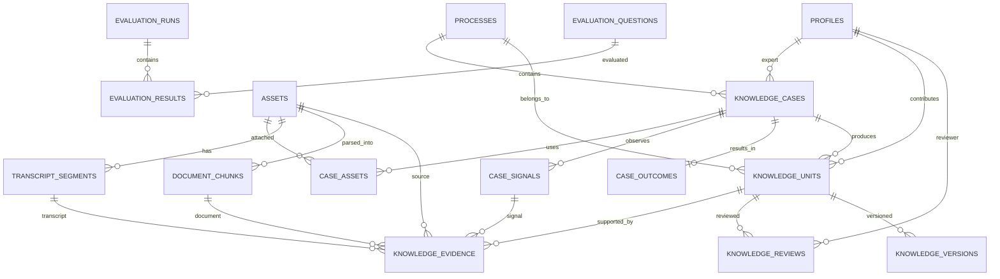

# MentorMind Database Design v1

> **Đã được thay thế một phần (29/9):** schema chạy thật là `infra/postgres/init.sql` v1.2 trên PostgreSQL tự host (không Supabase — architecture §8). Nơi hai bên lệch nhau, `init.sql` và `docs/contracts/` thắng: nhãn `public|synthetic|factory_confidential`, `knowledge_units` = WorkProfile, `reason_source` chỉ từ chuyên gia, một bảng vector `knowhow_chunks`.

## 1. Mục tiêu

Thiết kế này dùng **Supabase PostgreSQL + Supabase Storage + pgvector** cho flow:

```text
Case thực tế
→ Evidence
→ Transcript / OCR / Parsed Chunk / Signal
→ Knowledge Unit
→ Expert Review
→ Approved Knowledge
→ RAG / Assistant
→ Evaluation
```

Nguyên tắc quan trọng nhất là **không coi output của AI là knowledge chính thức ngay**. AI chỉ tạo `draft`; chỉ knowledge có `status = approved` mới được dùng làm nguồn chính cho Assistant.

---

## 2. Kiến trúc đề xuất

```text
Next.js / React
        │
        ▼
FastAPI Backend
        │
        ├──────────────► GPU Worker / RunPod
        │                ├─ ASR
        │                ├─ OCR
        │                ├─ VLM
        │                └─ Embedding / LLM
        │
        ▼
Supabase
├─ PostgreSQL
│  ├─ metadata
│  ├─ cases
│  ├─ knowledge
│  ├─ reviews
│  └─ evaluation
├─ Storage
│  ├─ public-samples
│  ├─ raw-evidence
│  └─ derived-artifacts
└─ pgvector
   ├─ document_chunks.embedding
   └─ knowledge_units.embedding
```

**Không đặt `SUPABASE_SERVICE_ROLE_KEY` trên frontend.** Backend FastAPI giữ key này và thực hiện write operations.

---

## 3. ERD



---

## 4. Các bảng cốt lõi

| Bảng | Vai trò |
|---|---|
| `profiles` | User/expert/reviewer, map với `auth.users` của Supabase |
| `processes` | Công đoạn/trạm sản xuất |
| `knowledge_cases` | Một case thực tế, phiên làm việc, interview hoặc troubleshooting |
| `assets` | Video/audio/PDF/XLSX/image/log; file thật nằm trong Storage hoặc URL public |
| `case_assets` | Nối một case với nhiều asset và ngược lại |
| `transcript_segments` | Transcript timestamp của video/audio |
| `document_chunks` | Kết quả parse/OCR + embedding phục vụ RAG |
| `case_signals` | Tín hiệu expert đang quan sát: ảnh, measurement, sensor... |
| `case_outcomes` | Kết quả cuối cùng/cause/action đã xác nhận |
| `knowledge_units` | Tri thức có cấu trúc để tái sử dụng |
| `knowledge_evidence` | Provenance/citation về timestamp, page, chunk, signal |
| `knowledge_reviews` | Expert approve/reject/request change |
| `knowledge_versions` | Snapshot từng version phục vụ audit |
| `evaluation_questions` | Golden QA |
| `evaluation_runs/results` | Kết quả benchmark từng model/retriever |

---

## 5. Knowledge Unit là trung tâm của hệ thống

Không lưu knowledge chỉ dưới dạng một đoạn text. Một `knowledge_unit` nên giữ:

```text
Context
Observation
Conditions
Action
Reasoning
Decision
Exceptions
Pass Criteria
Expected Outcome
```

Ví dụ:

```json
{
  "knowledge_type": "exception",
  "title": "Xử lý bất thường tại bước kiểm tra",
  "context": "Công đoạn A",
  "observation": "Phát hiện dấu hiệu bất thường",
  "action": "Dừng thao tác và kiểm tra",
  "reasoning": "Cần xác nhận trước khi tiếp tục",
  "exceptions": [],
  "status": "in_review"
}
```

Khi expert xác nhận:

```text
in_review → approved
```

Assistant production chỉ dùng `approved`.

---

## 6. Evidence / Provenance

Một knowledge unit có thể được hỗ trợ bởi:

```text
Video 00:01:20–00:01:32
+
Transcript segment
+
PDF page 7 / chunk 14
+
Machine signal
+
Confirmed outcome
```

`knowledge_evidence` giữ liên kết này.

Do đó khi Assistant trả lời có thể hiển thị:

```text
Nguồn:
- Expert session video 01:20–01:32
- Work Instruction, page 7
```

Thay vì chỉ trả lời từ embedding mà không truy vết được nguồn.

---

## 7. File Storage

Không lưu binary vào PostgreSQL.

### `public-samples`

Data public mà team thu thập trước vòng sâu:

```text
public-samples/
├─ documents/
│  ├─ pdf/
│  └─ xlsx/
└─ videos/
```

### `raw-evidence`

Sau này nếu DENSO cấp data thật và policy cho phép:

```text
raw-evidence/
{case_code}/
├─ video/
├─ audio/
├─ documents/
├─ images/
└─ logs/
```

### `derived-artifacts`

```text
derived-artifacts/
{case_code}/
├─ transcript/
├─ ocr/
├─ keyframes/
├─ parsed/
└─ embeddings/
```

Database chỉ giữ `storage_bucket` + `storage_path`.

---

## 8. Public sample hiện tại và data DENSO tương lai

Schema không hardcode `PACK01` hoặc case synthetic.

Các sample public hiện tại dùng:

```text
source_label = public
data_classification = public
```

Khi vào vòng sâu và DENSO cung cấp data:

```text
source_label = denso_internal

data_classification =
internal
hoặc confidential
hoặc restricted
```

Không cần thay schema.

---

## 9. Retrieval

Có hai loại index:

### Document RAG

```text
document_chunks
├─ search_tsv       → keyword/BM25-like PostgreSQL full-text
└─ embedding        → pgvector semantic search
```

### Verified Knowledge RAG

```text
knowledge_units
├─ search_tsv
└─ embedding
```

Pipeline nên ưu tiên:

```text
Query
→ keyword + vector retrieval
→ fusion/rerank
→ filter status=approved
→ retrieve evidence
→ LLM
→ answer + citation
```

MMORE chịu trách nhiệm ingestion/normalization.

Embedding sau khi tạo sẽ được lưu trực tiếp trong PostgreSQL
thông qua pgvector.

Supabase PostgreSQL là:
- source of truth;
- metadata store;
- vector store;
- retrieval index cho MVP.

---

## 10. Status flow

### Case

```text
draft
→ processing
→ in_review
→ verified
```

### Knowledge

```text
draft
→ in_review
→ approved
```

Nhánh lỗi:

```text
in_review → rejected
```

Hoặc:

```text
in_review
→ request_change
→ draft
→ in_review
```

---

## 11. Implementation order

### Step 1 — Database

Chạy:

```text
001_init_mentormind_supabase.sql
```

trong Supabase SQL Editor.

### Step 2 — Auth

Tạo user Supabase Auth và row tương ứng trong `profiles`.

### Step 3 — Sample data ingestion

Đưa các file public hiện có vào:

```text
assets
```

Sau đó:

```text
PDF/XLSX
→ parser/OCR
→ document_chunks

Video
→ ASR
→ transcript_segments
```

### Step 4 — AI extraction

Pipeline đọc evidence và tạo:

```text
knowledge_units.status = draft
```

### Step 5 — Expert Review UI

Reviewer:

```text
approve
reject
request_change
```

Ghi vào `knowledge_reviews`.

### Step 6 — RAG

Chỉ retrieve:

```sql
where status = 'approved'
```

### Step 7 — Golden QA

Nạp 20–30 câu vào `evaluation_questions`, chạy benchmark và ghi vào:

```text
evaluation_runs
evaluation_results
```

---

## 12. Phần nào cần làm ngay cho MVP?

Không cần implement toàn bộ UI cho 15 bảng.

MVP frontend/backend chỉ cần trực tiếp làm việc với:

```text
processes
knowledge_cases
assets
knowledge_units
knowledge_evidence
knowledge_reviews
document_chunks
transcript_segments
```

Các bảng:

```text
case_signals
case_outcomes
knowledge_versions
evaluation_*
```

nên tạo schema ngay từ đầu nhưng có thể chưa xây màn hình.

---

## 13. Quyết định quan trọng

### Không tạo bảng `videos`, `pdfs`, `xlsx` riêng

Tất cả nằm trong:

```text
assets
```

và phân biệt bằng `asset_type`.

Điều này giúp khi DENSO cung cấp thêm:

```text
CSV
sensor log
drawing
audio
image
```

không cần sửa schema.

### Không gắn knowledge trực tiếp vào file

Luôn:

```text
Case
→ Asset/Evidence
→ Knowledge Unit
→ Review
```

vì một knowledge unit có thể được chứng minh từ nhiều nguồn.

### Không overwrite knowledge khi expert sửa

Giữ `knowledge_versions` để audit.

---

## 14. Security baseline

- Frontend **không có service role key**.
- Raw file private bucket.
- Backend tạo signed URL khi cần xem file.
- RLS bật.
- Client chỉ được đọc `approved` knowledge.
- Dữ liệu DENSO sau này phải map đúng `data_classification`.
- Không gửi `confidential/restricted` data sang Colab/RunPod/cloud ngoài nếu policy DENSO chưa cho phép.

---

## 15. File migration

File đi kèm:

`001_init_mentormind_supabase.sql`

Trong file này đã có:

- tables
- foreign keys
- constraints
- indexes
- `pgvector`
- HNSW index
- full-text search index
- RLS baseline
- storage buckets
- `updated_at` triggers
- approved knowledge view

Trước khi chạy migration, chỉ cần chốt **embedding model**. File hiện mặc định `vector(1024)`.
